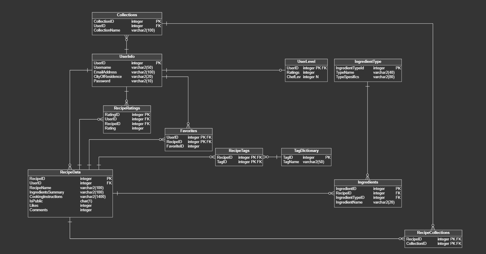

# Culina

A database project for a recipe-sharing platform. It stores users, recipes, ingredients, tags, ratings, favorites and collections.

## SQL Server

Run these files in order in an empty database:

1. `sql/sqlserver/schema.sql`
2. `sql/sqlserver/data.sql`
3. `sql/sqlserver/routines.sql`

## Oracle

Run these files in order:

1. `sql/oracle/schema.sql`
2. `sql/oracle/data.sql`
3. `sql/oracle/routines.sql`

The routines files include stored procedures, triggers and a few example checks. More SELECT queries are in `sql/queries.sql`.

The original project idea is in `docs/requirements.txt`.
